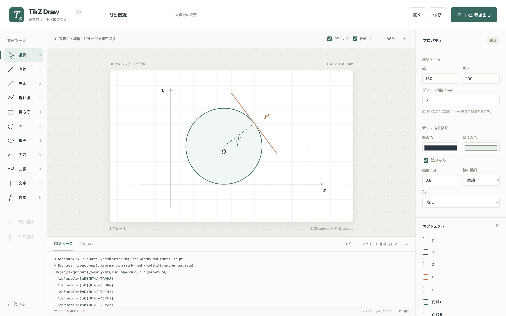

# TikZ Draw

WinTpic のようにマウスで図を描き、TikZ ソースを出力する Electron デスクトップアプリ。

直線・矢印・折れ線・長方形・円・楕円・円弧・ベジェ曲線と、文字・LaTeX 数式のラベルに対応します。
制御点の編集、複数選択、グリッド吸着、線と塗り、Undo/Redo を備えます。

## はじめに

macOS 版は `dist/TikZ Draw.app` を Finder で開きます。
ソースから起動する場合は [開発案内](CLAUDE.md#実行と検証) を参照してください。

「サンプルの図を開く」で編集を試せます。右のプロパティで数値を変更し、
「TikZ 書き出し」から TeX 原稿へ取り込めるソースを保存します。
操作説明はアプリ左下の「使い方」にあります。

## 保存形式

| 形式 | 用途 |
|---|---|
| `.tikzdraw` | 図形を再編集するためのファイル |
| `.tikz` | `tikzpicture` 環境。原稿から `\input{drawing.tikz}` で読み込む |
| `.tex` | プリアンブルを含む単体文書 |

`.tikz` の読み込み先では `\usepackage{tikz,amsmath,amssymb}` と
`\usetikzlibrary{arrows.meta}` を指定します。
日本語のラベルがあるときは原稿側にも日本語環境が必要です。
用紙の幅は、読み込み先の原稿の本文幅に合わせて調整してください。
単体 `.tex` は英数字のみなら pdfLaTeX、日本語を含む場合は LuaLaTeX を使います。

## 初版の範囲

数式の編集時表示は KaTeX を使用します。実際の TeX と字形・対応コマンドは完全には一致しません。
任意の TikZ ソースの読込や WinTpic 形式の変換は未対応です。
macOS のローカルビルド用で、配布用の Developer ID 署名・公証は行っていません。

出力例は [examples](examples/)、設計判断は [DESIGN.md](DESIGN.md)、現在状態は [SESSION.md](SESSION.md) にあります。

参照: [TikZ パス仕様](https://tikz.dev/tikz-paths)、[Electron のセキュリティ指針](https://www.electronjs.org/docs/latest/tutorial/security)。
