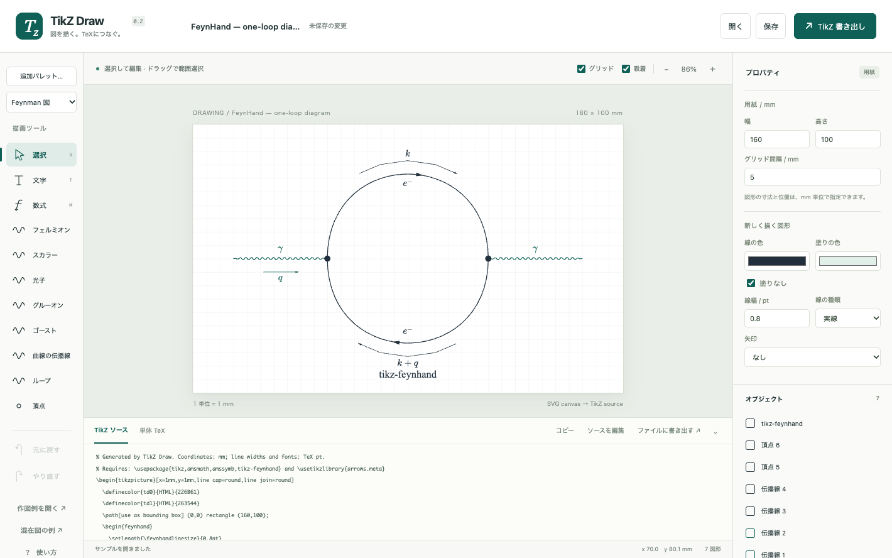
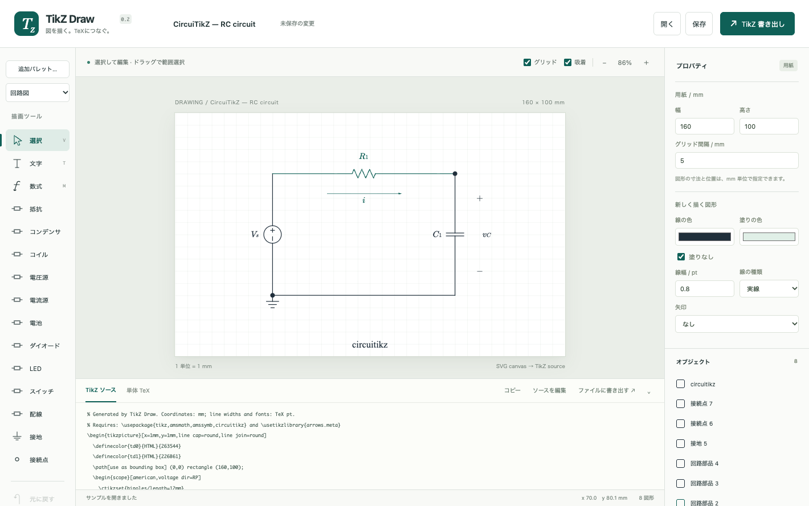

# TikZ Draw

WinTpic のようにマウスで図を描き、TikZ ソースを出力する Electron デスクトップアプリ。

直線・矢印・折れ線・長方形・円・楕円・円弧・ベジェ曲線と、文字・LaTeX 数式のラベルに対応します。
制御点の編集、複数選択、グリッド吸着、線と塗り、Undo/Redo を備えます。
v0.2 から、FeynHand・CircuiTikZ の作図と、対応する TikZ/TeX ソースの読込・編集に対応します。

## はじめに

macOS 版は `dist/TikZ Draw.app` を Finder で開きます。
ソースから起動する場合は [開発案内](CLAUDE.md#実行と検証) を参照してください。

「サンプルの図を開く」で編集を試せます。右のプロパティで数値を変更し、
「TikZ 書き出し」から TeX 原稿へ取り込めるソースを保存します。
操作説明はアプリ左下の「使い方」にあります。

## 追加パレット

通常作図がデフォルトです。「追加パレット…」または「表示」メニューから、
**Feynman 図**と**回路図**を個別に有効にします。初期状態では両方とも非表示です。
表示設定はこのマシンに保存され、パレットを非表示にしても作成済みの図は残ります。

- **Feynman 図**：フェルミオン・反フェルミオン・スカラー・光子・グルーオン・ゴースト、
  直線・曲線・ループ、4 種の頂点、粒子名と運動量・矢印。
- **回路図**：抵抗・コンデンサ・コイル・電圧源・電流源・電池・ダイオード・LED・スイッチ・配線、
  接地と接続点、米式／欧式、部品名・電圧・電流・端子。

それぞれの「作図例を開く」で試せます。同じ用紙に通常図形と専門図形を混在できます。

## ソースから編集

1. 「開く」で `.tikz` または `.tex` を選ぶと、対応する構文を図形として読み込みます。
2. 下部の「ソースを編集」で座標やラベルを変更し、「図に反映」でキャンバスを更新します。
3. 反映した変更は Undo で戻せます。未対応構文のエラー時は元の図と編集中のソースを保持します。
4. 「保存」は再編集用 `.tikzdraw` に保存します。読み込んだ TeX ファイルへ JSON を上書きしません。

アプリが出力する構文に加え、数値座標の単純な手書き TikZ / CircuiTikZ を読み込めます。
任意の TeX マクロ・独自スタイル・繰り返し・外部 `\input`・自動配置の逆解析は未対応です。
ソース反映後はアプリの書式へ整形し、元のコメントや字下げは保持しません。
詳しい対応範囲は [パッケージとソース読込](docs/package-support.md) を参照してください。

## 保存形式

| 形式 | 用途 |
|---|---|
| `.tikzdraw` | 図形を再編集するためのファイル |
| `.tikz` | `tikzpicture` 環境。原稿から `\input{drawing.tikz}` で読み込む |
| `.tex` | プリアンブルを含む単体文書 |

`.tikz` の読み込み先では `\usepackage{tikz,amsmath,amssymb}` と
`\usetikzlibrary{arrows.meta}` を指定します。
専門図形を使う場合は `tikz-feynhand` / `circuitikz` も必要です。
必要なパッケージは出力冒頭のコメントに表示し、単体 `.tex` では自動指定します。
日本語のラベルがあるときは原稿側にも日本語環境が必要です。
用紙の幅は、読み込み先の原稿の本文幅に合わせて調整してください。
単体 `.tex` は英数字のみなら pdfLaTeX、日本語を含む場合は LuaLaTeX を使います。

## 表示と対応範囲

数式の編集時表示は KaTeX を使用します。実際の TeX と字形・対応コマンドは完全には一致しません。
専門図形の編集画面も概略表示です。TeX のコンパイル結果そのものを表示しているわけではなく、
波線の位相、矢印、記号の寸法、ラベルの配置には差があります。
最終的な見た目は TeX の出力 PDF で確認してください。WinTpic 形式の変換は未対応です。
macOS のローカルビルド用で、配布用の Developer ID 署名・公証は行っていません。

出力例は [examples](examples/)、設計判断は [DESIGN.md](DESIGN.md)、現在状態は [SESSION.md](SESSION.md) にあります。

参照: [TikZ パス仕様](https://tikz.dev/tikz-paths)、[Electron のセキュリティ指針](https://www.electronjs.org/docs/latest/tutorial/security)。
